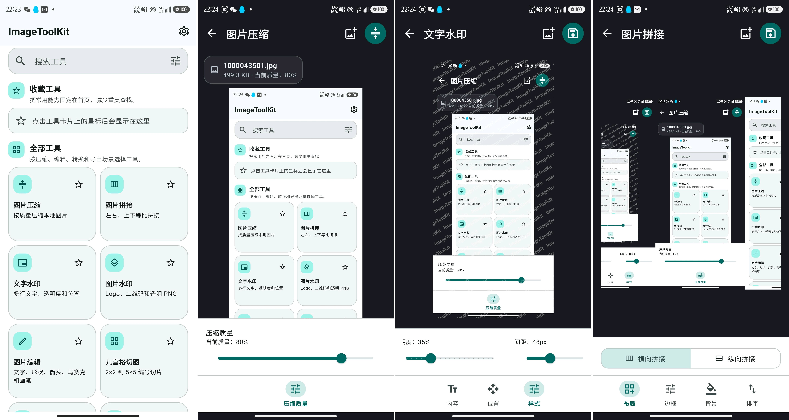

# ImageToolKit

ImageToolKit 是一个基于 Flutter 的本地图片处理工具箱。图片选择、编辑、导出、历史记录和常用参数均在设备本地完成，不依赖云端上传。

项目使用 Material Design 3、GetX、Drift 和 Android 平台通道，当前主要面向 Android，同时保留 Flutter 多平台项目结构。

## 项目预览



## 功能概览

### 图片编辑工作台

以下功能共用统一的沉浸式编辑工作台：

- 图片批注：文本、形状、箭头、画笔、马赛克、滤镜和基础变换
- 图片压缩：单图和批量压缩、质量调整
- 格式转换：JPG、PNG、WebP 等格式互转
- 图片裁剪：常用比例和自定义裁剪
- 图片滤镜：灰度、复古、电影等本地滤镜
- 图片翻转：水平和垂直翻转
- 宫格切图：按行列切分图片
- 图片拼接：横向、纵向和样式参数调整
- 尺寸调整：百分比和目标尺寸缩放
- 图片旋转：常用角度和自定义角度
- 文字水印：内容、位置、透明度和样式设置
- 图片水印：水印图片、位置、缩放、旋转和透明度设置

编辑页统一采用：

- 顶部辅助操作和主导出按钮
- 中部深色沉浸式画布
- 文件信息与导出结果浮层
- 上浮参数面板
- 固定底部工具坞

### 其他本地工具

- GIF 生成、拆帧和压缩
- 图片与 PDF 互转
- 二维码和条形码生成、识别
- 图片与 Base64 互转
- EXIF 查看和清理
- 图片颜色提取

### 本地管理

- 最近文件与操作历史
- 操作日志
- 收藏参数模板
- 缓存统计和清理
- 主题、语言和默认导出设置

## 技术栈

- Flutter 3.41.9
- Dart 3.11.5
- GetX：路由、依赖注入和响应式状态
- Drift + SQLite：设置、历史、日志、收藏和缓存记录
- `image`、`flutter_image_compress`：本地图片处理
- Android MethodChannel：本地文件选择、保存和部分平台能力

## 项目结构

```text
lib/
├── main.dart
└── app/
    ├── bindings/       # 全局依赖注入
    ├── database/       # Drift 数据库与表定义
    ├── exceptions/     # 应用异常
    ├── models/         # 输入、输出和持久化模型
    ├── pages/          # 按功能组织的 View、Controller、Binding
    ├── repositories/   # 本地数据仓库
    ├── routes/         # GetX 路由
    ├── services/       # 平台通道与基础服务
    ├── theme/          # Material 3 主题和多语言
    ├── utils/          # 编码、生成和提示工具
    └── widgets/        # 编辑工作台等公共组件
```

更完整的模块职责和数据流见 [项目架构说明](docs/architecture.md)。

## 环境准备

1. 安装 Flutter stable，并确认 Dart SDK 满足 `pubspec.yaml` 中的版本要求。
2. 配置 Android SDK、可用模拟器或 Android 设备。
3. 在项目根目录安装依赖：

```bash
flutter pub get
```

## 运行

```bash
flutter run
```

项目默认跟随系统主题和语言，也可以在设置页切换。

## 代码生成

修改 Drift 表、数据库定义或 JSON 注解模型后执行：

```bash
dart run build_runner build --delete-conflicting-outputs
```

请勿手工修改 `*.g.dart` 文件。

## 质量检查

```bash
dart format lib test
flutter analyze
flutter test
```

项目策略要求源码修改后至少执行一项检查；提交前建议执行全部命令。

## Android 自动发布

发布工作流位于 `.github/workflows/android-release.yml`。推送 `vX.Y.Z` 格式的
Git tag，或在 Actions 中手动输入一个已存在的发布标签后，工作流会执行代码
生成、格式检查、静态分析和测试，然后发布三个独立 APK：

- `armeabi-v7a`
- `arm64-v8a`
- `x86_64`

GitHub 仓库需要创建 `flutter_android_build` Environment，并配置以下 Secrets：

- `ANDROID_KEYSTORE_BASE64`：发布 keystore 的 Base64 内容，不能包含换行
- `ANDROID_KEYSTORE_PASSWORD`
- `ANDROID_KEY_ALIAS`
- `ANDROID_KEY_PASSWORD`

发布前工作流会逐个校验 APK 的 V2、V3 签名，并在 GitHub Release 中同时
上传 `SHA256SUMS.txt`。Dart 符号文件只作为 Actions 产物保留，不进入 Release。

## 应用内自动更新

Android Release 构建会在启动后最多每 24 小时检查一次 GitHub 最新正式版本，
也可以在“设置 > 软件更新”中手动检查。发现更新后，应用会根据当前 ABI
下载对应 APK，使用 Release 中的 `SHA256SUMS.txt` 校验文件完整性，再交给
Android 系统安装器完成签名校验和覆盖安装。

首次更新可能需要允许 ImageToolKit 安装未知应用。应用不会执行静默安装，
也不会读取 GitHub Token；仓库必须继续公开 Release，并保持现有
`imagetoolkit-<tag>-<abi>.apk` 与 `SHA256SUMS.txt` 资产命名。

当前 `v1.0.0` 尚未包含更新器，因此首个包含该能力的正式版本仍需手动安装；
之后发布的版本可以直接通过应用内更新流程获取。

## 编辑器扩展

新增图片编辑功能时，应复用 `ImageEditorScaffold`、`EditorDynamicToolPanel` 和 `EditorImagePreview`，不要为新页面复制顶部栏、画布和底部工具布局。

接入步骤、组件职责和测试清单见 [编辑工作台开发指南](docs/editor-workbench.md)。

## 文档

- [项目架构说明](docs/architecture.md)
- [编辑工作台开发指南](docs/editor-workbench.md)
- [稿定式图片编辑工作台改造设计](docs/superpowers/specs/2026-07-10-gaoding-style-image-editor-design.md)

## 隐私与安全

- 图片处理默认在设备本地执行。
- 项目不应硬编码密钥、令牌、签名文件或本机绝对路径。
- 导出失败时应保留原图，并向用户显示明确错误提示。
- 发布 APK 时必须按项目规范使用 V2 和 V3 签名并执行签名校验。
